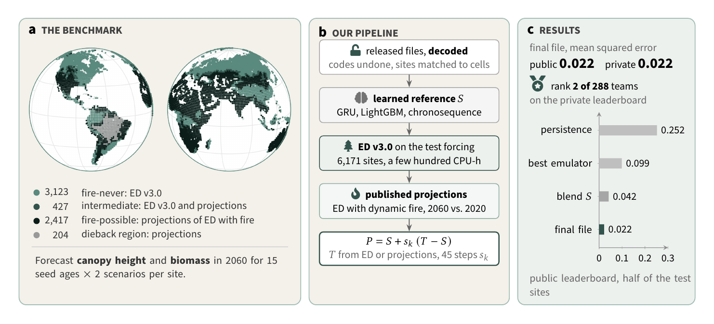
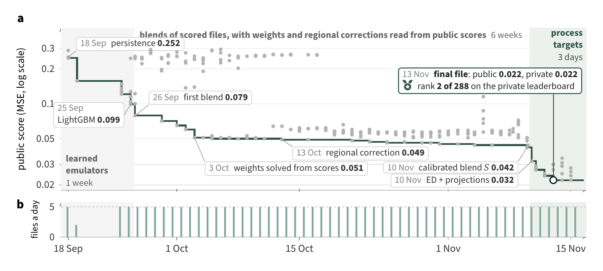
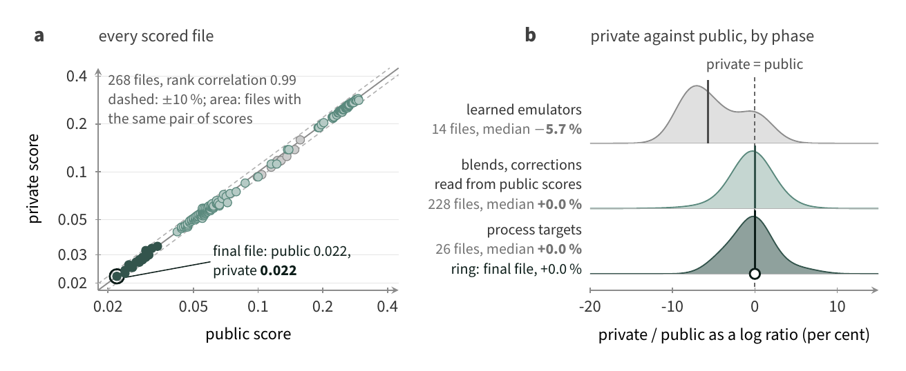

<p align="center">
  
</p>

<p align="center">
  
  
  
  
  
  
</p>

# Process-anchored emulation of forest carbon for CarbonGlobe 2026

This repository rebuilds the final submission of team **Lukas** (Kaggle user `lukasbuck`) for the
[AI Emulation Challenge](https://www.kaggle.com/competitions/ieee-bigdata-cup-2026-ai-emulation-challenge) of the IEEE BigData
Cup 2026 (CarbonGlobe) from the stored intermediates of the v1.0 release: one command, CPU only, 15 to 20 minutes. Method,
analysis and results are in [`REPORT.pdf`](REPORT.pdf) (extended technical report); the one-page report sent to the organisers is
[`docs/technical_report_short.pdf`](docs/technical_report_short.pdf).

Learned emulators that are excellent on the training climate lose a factor of eight to nine under the future climate of the test
runs. Every prediction is therefore anchored in the process model itself: `P = S + s_k (T - S)`, with a learned reference `S`, a
process target `T` from ED v3.0 runs on the decoded test forcing (or from published ED projections where fire shapes the stands)
and a step `s_k` per part of the file, read from public scores under priors and shrinkage.

## 🏁 Final submission

| File | Kaggle submission | Entered (UTC) | Public score | Private score |
| --- | --- | --- | --- | --- |
| `cand50_A.csv` | 58287788 | 2026-11-13 00:00:04 | 0.022 | **0.022** (rank 2 of 288) |

The file as submitted is attached to the [v1.0 release](https://github.com/L4XB/carbonglobe-solution/releases/tag/v1.0)
(`final.zip`, with `FINAL.json`). `python reproduce.py final` rebuilds it bit for bit (same md5).

<details>
<summary>How the score grew: 0.252, 0.099, 0.042, 0.022 in eight weeks</summary>



Six weeks of calibrating learned models reached 0.042; process targets halved it in three days. The final file scores the same on
the private half, and none of our 268 files scored on both halves does better there:


</details>

## 🌲 Quick start

```bash
# 1. code and environment: Python 3.12 with the pinned versions
git clone https://github.com/L4XB/carbonglobe-solution.git
cd carbonglobe-solution
python3.12 -m venv .venv && . .venv/bin/activate
pip install -r requirements.txt

# 2. stored intermediates and models: the v1.0 release assets, in a folder next to the repository
mkdir ../3_model_weights && cd ../3_model_weights
gh release download v1.0 -R L4XB/carbonglobe-solution   # or download every asset from the release page
shasum -a 256 -c SHA256SUMS.txt
unzip final.zip                  # final/cand50_A.csv and final/FINAL.json
tar -xJf emulators.tar.xz        # only needed for `reproduce.py emulators` (2.4 GB unpacked)
cd ../carbonglobe-solution

# 3. rebuild the final file and compare it with the submitted one (md5 and largest difference)
python reproduce.py final        # 15 to 20 min on 4 cores, 2 GB of disk; numpy and pandas only
```

`reproduce.py` reads the release assets from `../3_model_weights` (another folder with `--weights`) and works in `run/` (`--run`).
The competition data are not needed for `final`.

## 🔁 Reproducibility

`reproduce.py final` unpacks `artifacts_final.tar.gz` into `run/`, executes the command lines listed in `recipes/final.json` and
compares the rebuilt file with the submitted one. Three further checks:

```bash
python reproduce.py blend                                   # rebuilds the blend S from the scored probe files (~1 min)
python reproduce.py emulators --data /path/to/competition   # runs a GRU checkpoint and a LightGBM model on the test files
python reproduce.py checks                                  # recomputes the validation numbers of the report
```

| step | compared with | result (macOS on Apple silicon, Python 3.12, pinned packages) |
| --- | --- | --- |
| `final` | the submitted file | bit-identical (same md5) |
| `blend` | `results/spatcorr_stack_20261110_s08.csv` | bit-identical |
| `emulators`, LightGBM | `results/direct_gbdt2_m114.csv` (public score 0.104) | identical |
| `emulators`, GRU | `results/latent_noco2_m114.csv` (public score 0.127) | largest difference 4e-6 (CPU against the Apple GPU used originally) |

On a second machine (Linux x86_64, Python 3.12.3, numpy 2.5.4, pandas 3.1.0) `final` (16 minutes) and `blend` are bit-identical
as well, and `checks` prints the same numbers. A fresh clone of this repository with the assets downloaded from the v1.0 release
reproduced the final file bit for bit on 20 Nov 2026 (20 minutes on an Apple M-series Mac). Should a platform differ in the last digit of a few cells, the script reports the
largest difference instead of "identical".

What is stored rather than rebuilt: the ED outputs (ED's fire module makes repeated runs differ slightly, so a rerun cannot be
bit-identical), the projection rows (they need the 0.01-degree GeoTIFFs of the external data set), the blends before 10 Oct
(kept as scored files) and the small site tables listed in [`docs/STORED_INPUTS.md`](docs/STORED_INPUTS.md). The public
leaderboard is part of the method: the blend weights, the steps `s_k` and the block levels were read from the scores in
`results/board_scores.json`, and the scored files themselves are in `scored_files.tar.gz`.

## 🧭 How it works

[`docs/PIPELINE.md`](docs/PIPELINE.md) lists the scripts of every step.

1. **Preprocessing.** `scripts/cache_arrays.py` reduces the training arrays to yearly trajectories, annual means and the
   seasonal climatology of the forcing. `src/cgb/holdout.py` holds out 6,171 training sites (two halves). The test files are
   decoded (`src/cgb/shift.py`: floors and the factor 1.14114 of the stored states; `scripts/geo/`: the affine codes of the
   forcing channels), and 5,994 of the 6,171 test sites are matched to training cells by their static soil channels
   (`scripts/geo/cell_identity_global.py`).
2. **Learned emulators.** `scripts/train_latent.py` (GRU latent rollout, `src/cgb/latent.py`) and `scripts/direct_gbdt.py`
   (LightGBM); inference with `scripts/predict_latent.py` and `scripts/predict_gbdt.py`. Each checkpoint stores its own settings.
3. **Blend S.** Emulator outputs, persistence and the chronosequence predictor, combined with weights fitted to public scores
   (`scripts/file_solve.py`, `scripts/stack_blends.py`), plus a smooth regional correction (`scripts/spatial_correction.py`).
4. **Process targets.** ED v3.0 runs on the decoded test forcing (`scripts/ed/run_site.py`, `scripts/ed/run_many.py`, patches in
   `ed_patch/`), decoded into row targets by `scripts/ed/dec2.py`; runs with a site-tuned ignition strength
   (`scripts/ed/forced_fire.py`, `scripts/ed/ff_rows.py`); projection rows from Ma and Hurtt (2026, doi:10.3334/ORNLDAAC/2522)
   by `scripts/ornl/ornl_rows*.py`.
5. **Final file.** `scripts/design_run.py` reads a recipe and calls `scripts/build_candidate2.py` (targets and steps per part)
   and the level tools `scripts/apply_*.py`. `scripts/direct_batch.py` builds the block-level probe files,
   `scripts/readout_joint.py` turns their public scores into shrunk levels, and `scripts/second_stage.py` applies them.

## ⚙️ Environment and hardware

- Python 3.12; `requirements.txt` pins what we used. `final`, `blend` and `checks` need numpy and pandas only; `emulators` and
  training need PyTorch and LightGBM as well.
- Rebuilding the final file: any laptop (4 cores, 4 GB RAM, 2 GB disk).
- Training the GRU emulators: one GPU, about 6 minutes per epoch on an Apple M-series GPU (the per-epoch log of every checkpoint is
  in `emulators/<tag>/results.json`). LightGBM models train on CPU.
- The ED v3.0 runs: about 3 minutes per site on one core, about 300 CPU-hours for all 6,171 sites in the main pass (a Mac and an
  8-core Linux server). Their outputs are stored, so nobody has to rerun them.

The tools find everything relative to the folder that contains `scripts/` and `src/`:

```
data/test_ssp126.npz, data/test_ssp585.npz        competition test files (test_x, test_y0)
data/train/glob_X_fea.npy, glob_Y001.npy ...      CarbonGlobe training release (only for training and for building caches)
cache/                                            small release files: sample_submission.csv, data_stats.npz, age_triplet.npz, ...
work/                                             everything we computed (caches, models, ED runs, site tables, recipes)
results/                                          prediction files; results/board_scores.json = registry of public scores
```

`reproduce.py` creates this layout under `run/` from the release archives.

## 📦 Release assets (v1.0)

| asset | content |
| --- | --- |
| `final.zip` | `final/cand50_A.csv` (the submitted file) and `final/FINAL.json` (file name, md5, Kaggle submission, public score) |
| `artifacts_final.tar.gz` | every stored input of `reproduce.py final`: the blend S, ED outputs of all 6,171 sites, forced-fire ED outputs, projection rows, site tables, recipes ([`docs/STORED_INPUTS.md`](docs/STORED_INPUTS.md)) |
| `artifacts_blend.tar.gz` | inputs of `reproduce.py blend`: the stack of 10 Oct, the 137 scored probe files, the score registry as of 9 Nov, probe centres |
| `artifacts_emulators.tar.gz` | preprocessing constants of the release, the submission template and the two stored prediction files that `reproduce.py emulators` compares against |
| `artifacts_checks.tar.gz` | tables behind the validation numbers of the report: ED on 120 training cells, hold-out logs |
| `scored_files.tar.gz` | all other files that were scored on the public leaderboard (`results/board_scores.json` names their scores) |
| `emulators.tar.xz` | every emulator checkpoint of the project: GRU latent rollouts (`latent_<tag>/model.pt`, `results.json`) and LightGBM boosters as text (`direct_<tag>/`) |
| `MANIFEST.sha256`, `README.md` | checksums of every unpacked file, and the description of the weights folder as sent to the organisers |
| `SHA256SUMS.txt` | checksums of the release assets themselves |

All emulator checkpoints are included because the blend S is a linear combination of many scored files and most models
contributed to at least one of them. The two models the report quotes are `latent_noco2` (GRU, public 0.127) and `direct_gbdt2`
(LightGBM, public 0.104). ED v3.0 itself has no trained weights; its outputs for the test sites are stored.

## Repository layout

```
reproduce.py            the four checks above
recipes/                exact command lines of every reproduction step (JSON)
requirements.txt        pinned packages
src/cgb/                library: data access, hold-out split, decode of the test states, GRU model, submission format
scripts/                tools, at the relative paths they call each other with (see docs/PIPELINE.md)
scripts/ed/             ED v3.0: inputs, runs, decoding, validation on training cells
scripts/ornl/           projection rows from the external biomass projections
scripts/geo/, nex/      decoding of the test files, cell match
scripts/fire/           ED's ignition rule evaluated on site climates
scripts/sim/            synthetic leaderboards (transfer of fitted corrections to unseen sites)
scripts/report/         numbers of the one-page report
ed_patch/               our changes to the public ED v3.0 source as patches
docs/                   PIPELINE.md, STORED_INPUTS.md, the one-page report, README images
REPORT.pdf              extended technical report
```

## External material and licences

- **ED v3.0 source code:** Ma et al. (2022), Geosci. Model Dev. 15, 1971-1994, code archive on Zenodo. Not redistributed here;
  `ed_patch/` holds our changes only.
- **Biomass projections:** Ma, L. and Hurtt, G. (2026), ORNL DAAC, doi:10.3334/ORNLDAAC/2522. Only the values extracted at the
  test cells are stored.
- **NEX-GDDP-CMIP6** (Thrasher et al. 2022) was used to decode the climate channels of the test files.
- No test label was used. The competition data are not redistributed; download them from the
  [competition page](https://www.kaggle.com/competitions/ieee-bigdata-cup-2026-ai-emulation-challenge/data).
- **Licence:** MIT ([`LICENSE`](LICENSE)) for our code; the patches in `ed_patch/` apply to ED's source, which keeps its own terms.
